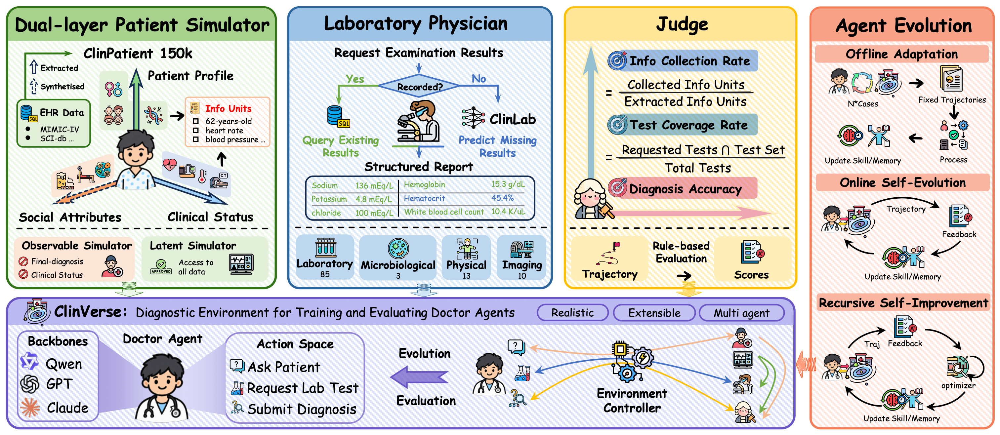

# ClinVerse

**A clinical environment for evaluating and training medical agents.**

ClinVerse combines EHR-grounded case construction, a multi-role diagnostic environment, five evaluation metrics, and episodic agent training.

[](https://sirrychen.github.io/blogs/ClinVerse/)
[](https://github.com/SirryChen/ClinVerse)




## Environment

```bash
git clone https://github.com/SirryChen/ClinVerse.git
cd ClinVerse
conda env create -f environment.yml
conda activate clinverse
cp .env.example .env
set -a
source .env
set +a
```

| Workflow | Environment |
|---|---|
| Data processing | Python 3.11, JDK 17, Git and an information-extraction endpoint |
| Agent evaluation | Patient, doctor and ClinLab endpoints |
| MemRL | An embedding endpoint; default model: BAAI/bge-m3 |
| Local Qwen3-32B serving | Reference: 2 × 80 GB NVIDIA GPUs |
| ClinLab LoRA training | Reference: 1 × 48 GB GPU, bfloat16, sequence length 4,096, batch size 1 |

API clients and tests run on CPU. GPU memory use depends on precision, context length and concurrency. Use 64 GB or more of host RAM for full-dataset preprocessing. Endpoints and model names are configured in `.env` and `config/default.yaml`.

## 1. Data processing

| Source | Download |
|---|---|
| MIMIC-IV 3.1 | [PhysioNet](https://physionet.org/content/mimiciv/3.1/) |
| MIMIC-IV-Note 2.2 | [PhysioNet](https://physionet.org/content/mimic-iv-note/2.2/) |
| SICdb 1.0.8 | [PhysioNet](https://physionet.org/content/sicdb/1.0.8/) |
| Synthea | [Source](https://github.com/synthetichealth/synthea) |

Normalize records, build examination catalogs, generate conditioned patient backgrounds, extract information units and assemble cases:

```bash
python scripts/prepare_data.py \
  --mimic-dir ../dataset/mimic-iv-3.1 \
  --note-dir ../dataset/mimic-iv-note/2.2 \
  --synthea-root ../synthea \
  --setup-synthea \
  --extractor-provider extractor \
  --resume

python scripts/split_cases.py --cases-dir data/cases --output data/splits
```

Use `--limit 100` for a smaller run or `--plan` to inspect the stages. Outputs are written to `data/normalized/mimic-iv-ext/`, `data/cases/` and `data/preparation/`. Split manifests group admissions by patient.

[Data processing guide](docs/data.md)

## 2. Agent evaluation

An agent implements `reset(context)`, `act() -> Action` and `observe(text)`. The context contains the initial presentation, available tool schemas and turn budget. Completed scores are handled by the evaluator.

[Agent protocol](agents/interfaces.py) · [OpenAIAgent implementation](examples/openai_agent.py)

```bash
python scripts/run_agent.py \
  --agent examples.openai_agent:OpenAIAgent \
  --case-ids-file data/splits/test.txt \
  --n 100 \
  --output outputs/evaluation/reference
```

Select another implementation with `--agent my_package.my_agent:MyAgent`. The evaluator writes trajectories, per-case scores and an aggregate summary containing **ICR ↑, TOC ↑, ATC ↑, DCA ↑ and DSA ↑**.

```bash
python scripts/run_batch_eval.py \
  --include-case-ids-from data/splits/test.txt \
  --n 100 --repeats 5 \
  --output-root outputs/benchmark/reference
```

[Agent evaluation guide](docs/evaluation.md)

## 3. Agent training

A trainer implements `context(episode)`, `update(record)` and `save(path)`. It receives the presentation and tools before each encounter, then learns from the completed trajectory and scores. [MemoryTrainer](examples/memory_trainer.py) implements semantic recall followed by utility-based memory selection.

```bash
python scripts/run_agent.py \
  --agent examples.openai_agent:OpenAIAgent \
  --trainer examples.memory_trainer:MemoryTrainer \
  --trainer-state outputs/training/memory.json \
  --case-ids-file data/splits/train.txt \
  --n 100 --output outputs/training/episodes
```

Evaluate the saved state:

```bash
python scripts/run_agent.py \
  --agent examples.openai_agent:OpenAIAgent \
  --memory-state outputs/training/memory.json \
  --case-ids-file data/splits/test.txt \
  --n 100 --output outputs/evaluation/trained
```

[MemRL and custom training](docs/training.md) · [ClinLab training](docs/clinlab.md)

## Interfaces

| Interface | Entry point |
|---|---|
| Environment | `ClinicalEnv.reset()`, `step(tool, args)`, `score()` |
| Agent loop | `env.runner.run_episode(env, agent)` |
| Case collection | `TaskStream(cases_dir)` |
| HTTP environment | `python scripts/run_api_server.py --port 8080` |

## Development

```bash
python -m pytest tests -q
python scripts/package_release.py --output ../ClinVerse-source-v0.3.0.tar.gz
```

[Apache-2.0](LICENSE)
